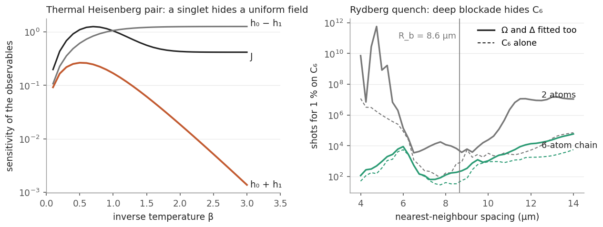
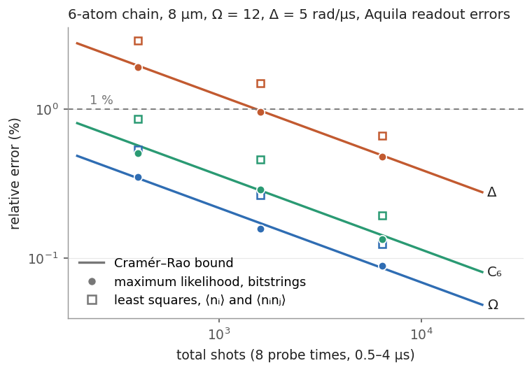
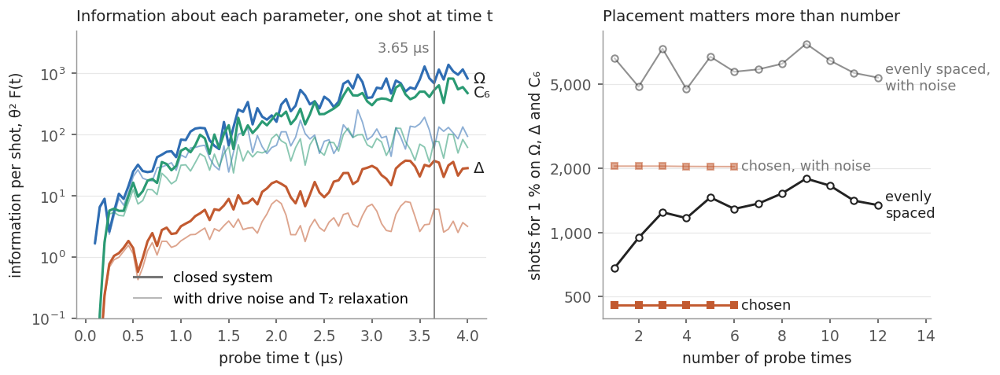
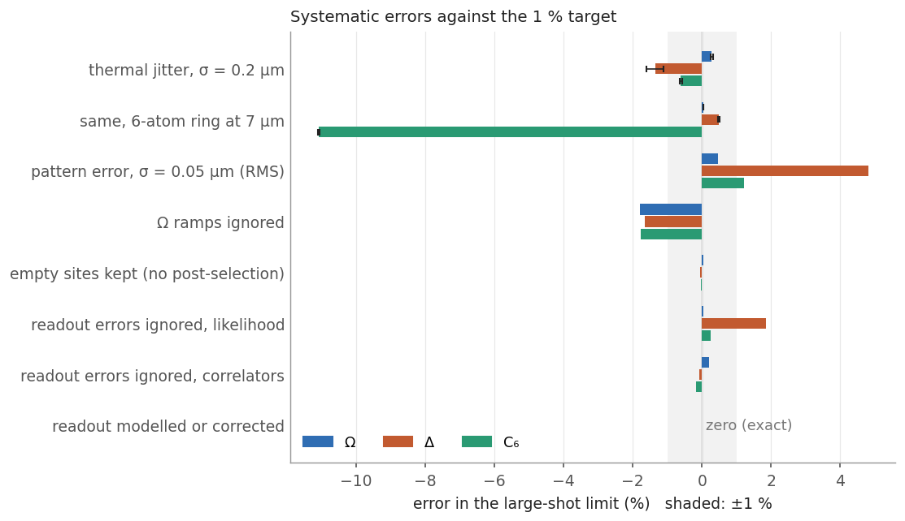
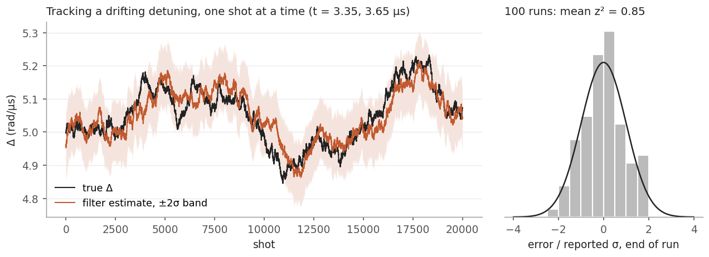

# shadow-hamiltonian-learning

Learning the Hamiltonian of a small quantum device from single-shot measurements, starting with what those measurements cannot determine.

[](https://github.com/Jaspersands/shadow-hamiltonian-learning/actions/workflows/ci.yml)
[](LICENSE)

The package has two parts.

The first works with classical shadows of thermal states. Single-shot measurements in random bases give unbiased estimates of many observables at once. From those estimates the package recovers the couplings of a Heisenberg model or tracks them as they drift. It also covers chosen bases, exact correction of asymmetric readout errors, fermionic (matchgate) shadows, and process tomography constrained to physical channels.

The second learns the Hamiltonian of a Rydberg atom array (Ω, Δ and C6) from computational-basis snapshots of quench dynamics. That is the only readout an analog neutral-atom device such as QuEra's Aquila provides.

Both parts ask the same two questions: what can these measurements determine at all, and how many shots does it take?

[Interactive page](https://shadows.jaspersands.com/): shadows of a thermal Heisenberg chain in the browser. The inversion, the basis comparison and the Kalman filter run in a background worker.

## What can and cannot be learned from this data



### Thermal Heisenberg pair

The Hamiltonian is H = J σ₀·σ₁ + h₀Z₀ + h₁Z₁, with J = 0.75 and h = (0.2, −0.15). At low temperature the thermal state is mostly the singlet, with weight 0.96 at β = 1.5. The singlet has total S_z = 0, so a uniform field leaves it unchanged. The combination h₀ + h₁ therefore acts only on the triplet, whose population is thermally suppressed.

The left panel shows how strongly the measured observables respond to each parameter combination. At β = 1.5 the response to h₀ + h₁ is 0.06, against 1.22 for h₀ − h₁. That ratio of 20 means the same precision on h₀ + h₁ takes about 400 times as many shots. At β = 3 the ratio is about 900, and no estimator recovers h₀ + h₁ from such data at a reasonable shot count. `identifiability()` reports this from the Jacobian's singular values before any fitting: the condition number is 3.1 at β = 0.3 and 21 at β = 1.5.

### Rydberg quench with Z-basis readout only

Start with every atom in the ground state. These changes then leave every outcome probability exactly unchanged, so no amount of data fixes them:

- The drive phase. Conjugating by Π_i exp(−iφ n_i) fixes the initial state and the measurement. For a real drive this is the sign of Ω.
- The signs of Δ and C6 together. H is a real matrix at every moment of the pulse, so H and −H give the same probabilities. Combined with the first symmetry, this flips Δ and C6 at fixed Ω. The sign of Δ is defined only relative to the sign of the interaction. With per-site offsets, the offsets flip too.
- Rates and durations. Multiplying Ω, Δ and C6 by a and dividing every duration, ramps included, by a changes nothing. The data fix rates times durations, so the absolute values rest on the device clock.
- C6 and the array's length scale. Only C6/s⁶ enters, so calibrating C6 and calibrating the atom positions are one measurement.
- With per-site offsets δ_i, only Δ + δ_i enters, so Δ and the mean offset are one parameter.

These were checked numerically. For the Ω flip, the largest change in any outcome probability is exactly 0. For the sign pair and the length scale it is below 5 × 10⁻¹⁵, and the tests check the other two. Flipping Δ alone changes some probabilities by 0.38.

Within what remains, the least well determined combination in the reference configuration below is mostly Δ with some C6. In relative units it is (Ω, Δ, C6) ≈ (−0.07, 0.97, 0.22), and the Δ–C6 correlation is 0.75.

The right panel shows a second limit. Deep inside the blockade radius, states with two neighbouring excitations are never populated (Gaëtan et al. 2009; Browaeys and Lahaye 2020), and C6 drops out of the data. For two atoms closer than 5.5 μm, 1 % on C6 takes between about 10⁷ and 10¹² shots. Between 6.5 and 10 μm the pair needs 3,500 to 25,000 shots, and the curve has structure from resonances such as V = 2Δ at 9.0 μm, where |rr⟩ is degenerate with |gg⟩. From 11 μm on, the pair loses C6 again when Ω and Δ are fitted alongside it (2.2 million shots at 11 μm), because a weak interaction and a small change of Δ act almost alike. With Ω and Δ known, C6 alone needs 2,900 shots at 11 μm (dashed lines). A six-atom chain keeps C6 visible through next-nearest neighbours, at twice the spacing. It needs at most 9,000 shots anywhere between 4 and 11 μm, with the worst point at 6 μm, and fewer than 1,300 between 6.5 and 10 μm. These counts are Cramér–Rao numbers, with Ω and Δ fitted alongside C6 unless marked, eight probe times and Aquila's readout errors.

## Learning a Rydberg Hamiltonian from snapshots

Learning a Hamiltonian from local measurements or from quench dynamics has a substantial literature (Bairey, Arad and Lindner 2019; Li, Zou and Hsieh 2020; Anshu et al. 2021). The aim here is narrower: what Aquila's own readout, one bitstring per shot after a single pulse, can calibrate, and at what cost.

The model is

$$H/\hbar = \frac{\Omega(t)}{2}\sum_i X_i - \Delta \sum_i n_i + \sum_{i<j} \frac{C_6}{|r_i - r_j|^6}\, n_i n_j ,$$

with n = |r⟩⟨r|. Ω and Δ are in rad/μs, positions in μm and times in μs. Per-site detuning offsets are optional. This is the Hamiltonian of the Aquila paper (Wurtz et al. 2023) and of the Amazon Braket analog Hamiltonian simulation documentation, with the drive phase at zero and no local detuning.

The protocol:

1. Prepare |g…g⟩.
2. Apply one pulse of duration T. Ω(t) rises linearly from 0 over 0.05 μs, stays at Ω, and falls back to 0 at T. Δ is constant and the phase is zero.
3. Read every atom out in the computational basis at T, after the drive is off.

A probe time is therefore a total pulse duration. Braket requires Ω to start and end at 0, time points on a 1 ns grid at least 0.05 μs apart, and an Ω slew rate within the device limit: 250 rad/μs² in the Aquila paper, 400 in the current Braket device capabilities. A 0.05 μs ramp to Ω = 12 rad/μs is 240 rad/μs², so this is the shortest pulse the device accepts. `waveform` returns the Braket time series and `waveform_violations` checks it against these rules.

Each shot gives one bitstring. The simulation is an exact state vector: up to 10 atoms for fitting and up to 14 for sampling. The ramps are simulated as eight piecewise-constant slices each; against 256 slices the largest probability error is 8 × 10⁻⁵. Optional effects are readout errors, position jitter drawn afresh each shot, shot-to-shot drive noise, a relaxation model and empty sites.

The reference configuration for the numbers below:

- six atoms in a chain at 8 μm spacing
- Ω = 12 rad/μs and Δ = 5 rad/μs, giving a nearest-neighbour V of 20.7 rad/μs and a blockade radius of 8.64 μm
- eight pulses with durations evenly spaced from 0.5 to 4 μs
- Aquila's readout errors from the 2023 paper: a ground-state atom is read as Rydberg with probability 0.01, and a Rydberg atom is read as ground with probability 0.08. The current Braket figures are worse (0.05 and 0.10); the shot counts below are given under both.

`python benchmarks/make_figures.py` produces the figures, `figures/findings.json` and every number in this section except the example and command-line outputs, which come from running them. It takes about 37 minutes.

### Estimators against the Cramér–Rao bound



There are two estimators:

- `fit_mle`: maximum likelihood on the full bitstring distribution.
- `fit_correlators`: generalised least squares on the readout-corrected ⟨n_i⟩ and ⟨n_i n_j⟩, weighted by the exact model covariance.

Both use exact gradients, including through the ramps. The table gives relative RMSE over 200 seeded trials, with starting points up to 8 % from the truth. With 200 trials the RMSE values have about 5 % sampling error. These trials use the fit's continuation alone (`search=False`, below), which finds the global maximum on this chain and takes about 1 s per fit instead of 5 s.

| shots per time (total) | | Ω | Δ | C6 |
|---|---|---|---|---|
| 200 (1,600) | Cramér–Rao bound | 0.17 % | 0.98 % | 0.28 % |
| | maximum likelihood | 0.16 % | 0.95 % | 0.29 % |
| | least squares on ⟨n_i⟩, ⟨n_i n_j⟩ | 0.26 % | 1.49 % | 0.46 % |
| 800 (6,400) | Cramér–Rao bound | 0.09 % | 0.49 % | 0.14 % |
| | maximum likelihood | 0.09 % | 0.48 % | 0.13 % |
| | least squares on ⟨n_i⟩, ⟨n_i n_j⟩ | 0.12 % | 0.66 % | 0.19 % |

At 50 shots per time (400 in total) the likelihood fit is close to the bound too, with RMSE 0.35 %, 1.90 % and 0.51 % in Ω, Δ and C6, against a bound of 0.34 %, 1.95 % and 0.57 %. Across the three budgets the likelihood RMSE is 0.89 to 1.04 times the bound. The largest departure, 0.89 for C6 at 50 shots per time, is about two standard errors.

The one- and two-body correlators carry about half of the information in the bitstrings; their own bound is 1.46 to 1.55 times the full one. Least squares on them therefore needs roughly twice the shots for the same error.

### Does the fit find the right maximum?

The likelihood of a late probe time oscillates in θ, and along C6 it has local maxima where the phase of the most strongly interacting pair, V_max·T_max, has wrapped by 2π. They sit a relative step 2π/(V_max T_max) apart: 7.6 % of C6 for the reference chain, 3.4 % for a chain or ring at 7 μm and 2.2 % at 6.5 μm. A fit that starts a few per cent off can stop in one of them, or run far off in the early stages. `fit_mle` has three defences:

1. Continuation. Probe times are added one at a time in increasing order. The first stage fits Ω alone, from the best point of a grid over ±30 %, and the stages before the last keep every parameter within ±30 % of the start.
2. Search, on by default up to 8 atoms. Three more continuation runs start from seeded points within ±8 % of the start. From the best result, the fit then tries the opposite sign of Δ and C6 shifted by every whole multiple of the step above out to ±25 %. That is 6 extra fits for the reference chain and 22 at 6.5 μm, but 110 at 5 μm, where `comb_range` can be lowered. The best maximum is returned. Others within 3 log-likelihood units are listed in `fit.alternatives`, since the data cannot tell them apart.
3. Checks. A χ² test of the readout-corrected ⟨n_i⟩ and ⟨n_i n_j⟩ against the fitted model (`goodness_of_fit`) catches fits that are stuck or a model that is wrong. A non-converged optimiser, p < 10⁻³ or a close alternative maximum each add a line to `fit.warnings` and make `fit.success` false. The command-line tool prints them.

These are heuristics, tested on the arrays in the tables below and nowhere else.

With exact expected counts (200 shots per time, eight times) the truth is the global maximum, so any other answer is wrong. Each row is 15 starts within ±8 % of the truth:

| array | step along C6 | continuation alone: truth found | wrong, no warning | full fit: truth found | flagged | wrong, no warning |
|---|---|---|---|---|---|---|
| 6-atom chain, 8 μm (reference) | 7.6 % | 15 | 0 | 15 | 0 | 0 |
| 6-atom ring, 7 μm | 3.4 % | 14 | 1 | 15 | 0 | 0 |
| 4-atom chain, 7 μm | 3.4 % | 12 | 3 | 15 | 0 | 0 |
| 3-atom chain, 6.5 μm | 2.2 % | 10 | 5 | 15 | 15 | 0 |
| 6-atom chain, 6.5 μm | 2.2 % | 13 | 2 | 15 | 15 | 0 |
| 2 atoms, 8 μm | 7.6 % | 15 | 0 | 15 | 0 | 0 |
| 2 atoms, 6.5 μm | 2.2 % | 10 | 4 | 15 | 15 | 0 |

With sampled data (200 shots per time, 16 seeds), a fit more than 4 reported σ from the truth is wrong in practice:

| array | flagged | of which close alternatives | more than 4σ off | more than 4σ off, no warning |
|---|---|---|---|---|
| 6-atom chain, 8 μm (reference) | 0 of 16 | 0 | 0 | 0 |
| 4-atom chain, 7 μm | 12 of 16 | 12 | 3 | 1 |
| 6-atom ring, 7 μm | 1 of 16 | 1 | 0 | 0 |

At 6.5 μm the search always finds the truth, and it always warns. With exact counts it lists the other maxima within 3 log-likelihood units of the truth: 3 for the six-atom chain, between −4.7 % and +2.5 % in C6, but 16 for three atoms and 10 for the pair, spread over the whole ±25 % searched. The closest on either side sit 2.0 to 4.5 % away and 0.19 to 1.2 units below the truth. At this shot count the data do not decide between them, and the local Cramér–Rao bound (0.7 % on C6 for three atoms) understates the uncertainty. With sampled data the best maximum can then be far from the truth: `shadow-learn rydberg --atoms 3 --spacing 6.5` returns C6 23 % high and warns about six other maxima within 3 log-likelihood units, from 24 % below to 7 % above the estimate in C6. The one nearest the truth fits 1.7 units worse than the estimate. More shots, or more probe times at different durations, separate the maxima.

On the 4-atom chain at 7 μm, one sampled fit in 16 was more than 4σ off without a warning. There the data themselves favour the wrong maximum by 4.7 log-likelihood units over the one next to the truth, more than the threshold of 3 for listing alternatives, so no search could have told. Raising `ambiguity` catches more such cases at the price of more warnings.

### How many shots, and when to measure



Information per shot grows with evolution time for all three parameters. It peaks near the end of Aquila's 4 μs window: at 3.8 μs for Ω and C6 and at 3.35 μs for Δ.

The probe times were chosen by coordinate exchange on a 0.05 μs grid, minimising the worst relative variance. However many times are allowed, the search puts all of them at 3.65 μs.

Shots for 1 % on Ω, Δ and C6, with the device figures from the 2023 paper and with the current Braket figures (see the device table below):

| design | 2023 paper | current Braket |
|---|---|---|
| 8 times evenly spaced, 0.5–4 μs | 1,528 | 2,350 |
| all shots at 3.65 μs | 455 | 633 |
| 80 % at 3.65 μs, 5 % each at 0.75, 1.5, 2.25 and 3.0 μs | 535 | 747 |
| 8 evenly spaced, no readout errors | 782 | 782 |
| 8 evenly spaced, with drive noise and relaxation | 6,209 | 13,872 |
| all shots at 3.65 μs, with drive noise and relaxation | 2,051 | 4,948 |

These are Cramér–Rao totals at which every relative standard deviation reaches 1 %. Readout errors alone double the shot count with the paper's figures and triple it with Braket's.

Most of the further factor in the noise model, four with the paper's figures and six with Braket's, comes from relaxation, and that part is the least certain. For the evenly spaced design:

| noise model | 2023 paper | current Braket |
|---|---|---|
| none | 1,528 | 2,350 |
| drive noise only (Δ 0.18 rad/μs, Ω 0.8 %, shot to shot) | 1,837 | 2,779 |
| relaxation only, at T₂ echo (11.4 μs; 7 μs) | 5,508 | 12,570 |
| both | 6,209 | 13,872 |
| drive noise, relaxation at 2 × T₂ echo | 3,679 | 7,065 |
| drive noise, relaxation at T₂ Rabi (7.5 μs; 7 μs) | 9,692 | 13,872 |

The relaxation model is a per-atom bit flip toward 1/2. It applies a dephasing time measured without drive to driven dynamics, ignores asymmetric decay to the ground state and atom loss, and can populate |rr⟩ inside the blockade, which real decay would not. Read the noisy counts as a range, not a prediction: roughly 3,700 to 9,700 shots with the paper's figures and 7,100 to 13,900 with Braket's. If Braket's 2 % variation of Ω over time is all shot to shot, the Braket count with drive noise and relaxation rises to 15,811.

The single-time optimum is local and sharp:

| probe time (μs) | 3.55 | 3.60 | 3.65 | 3.70 | 3.75 |
|---|---|---|---|---|---|
| shots for 1 % | 1,786 | 768 | 455 | 639 | 1,769 |

A 0.05 μs error in the pulse duration costs 40 to 70 % more shots. The optimum also moves with the nominal values used to find it: designing with Ω or C6 2 to 3 % off picks 3.6 or 3.7 μs, which costs up to 768 shots at the true values.

Two further caveats:

- With all shots at one time the likelihood has many local maxima. From starting points 10 % off, 27 of 30 fits converged with all shots at 3.65 μs, and the other three carried warnings: none was wrong without one. With a few shots at earlier times, 30 of 30 converged. Both runs used twice the 1 % budget. The anchored design costs 18 % more shots and is the one to use.
- The closed model's information keeps growing with time, so its optimum sits near the edge of the window. With drive noise and relaxation, the peaks for the individual parameters move earlier: 2.85 μs for Ω, 2.0 μs for Δ and 3.25 μs for C6. The minimax design still sits at 3.4 to 3.65 μs.

### Systematic errors



These are errors in the large-shot limit, from fits to expected counts with no shot noise. Each effect is present in the data and left out of the fitted model. The fits start at the truth, so they report where the fit lands with unlimited data. For the jitter rows the fit was repeated from a start 3 % off, with the same result, and the maximum next to the truth (a local fit from the truth to all probe times at once) is reported as well.

Thermal position jitter of σ = 0.2 μm per in-plane coordinate, drawn afresh each shot:

- On the reference chain the fit lands at +0.28 % in Ω, −1.36 % in Δ and −0.61 % in C6, with Monte Carlo error 0.12 % or less. The goodness-of-fit test rejects the model at 1,000 shots per time (p ≈ 10⁻¹³⁴).
- These numbers depend on details of the pulse: with an instantaneous quench the same fit gives −0.60 %, −0.58 % and −2.5 %. A jitter bias is not a correction to subtract. At Aquila's specified jitter, calibrating to 1 % needs the jitter in the model. `averaged_probabilities` computes the jitter-averaged distribution; the fitters do not use it yet.
- The reference spacing is 0.93 R_b, close to where the dynamics are most sensitive to distances, and C6 and the positions enter through the same factor C6/r⁶.
- On a six-atom ring at 7 μm (0.81 R_b) the best fit to the jitter-averaged data has C6 11 % low, with Ω and Δ within 0.5 %. The goodness-of-fit test does not notice at 1,000 shots per time (p = 0.14). The maximum next to the truth, at −3.4 % in Δ and −0.7 % in C6, fits worse by 155 log-likelihood units.
- Single runs scatter over these maxima. `shadow-learn rydberg --geometry ring --spacing 7 --jitter 0.2` returns C6 13 % low with a goodness-of-fit p of 0.37. The tool warns whenever jitter is in the data, because the test cannot be relied on to catch it.

Pattern error, a fixed offset of σ = 0.05 μm per coordinate at every site:

- The RMS error over 80 random patterns is 0.45 % in Ω, 4.8 % in Δ and 1.2 % in C6.
- A 0.05 μm offset changes a nearest-neighbour interaction by about 4 %, or 0.8 rad/μs. The fit absorbs much of that into Δ, the weakest direction.
- Δ to 1 % needs site positions known several times better than 0.05 μm, or fitted. Simard et al. (2025) learn the interaction matrix from correlations for this reason.

Ramps ignored:

- An instantaneous-quench model fitted at the total pulse durations returns all three parameters 1.6 to 1.8 % low: −1.81 % in Ω, −1.65 % in Δ and −1.77 % in C6. By the rate–duration symmetry, a shorter effective duration reads as lower rates. The goodness-of-fit test notices at 1,000 shots per time (p = 7 × 10⁻¹³).
- Fitted at durations shortened to give the same pulse area (T − 0.05 μs), the error drops to 0.10 % in Δ and 0.015 % or less in Ω and C6.
- Braket's device properties list a Rabi-frequency correction of 0.92 for 50 ns ramps, 0.97 for 75 ns and 1.0 for 100 ns. The Braket schema (reference 6) defines it as the effective on-resonance Rabi frequency of a triangular pulse relative to the specified one, so 50 ns ramps deliver 92 % of their nominal area. The model does not apply it, and a fit with nominal ramps is then off by about −0.14 % in all three. Ramps of 0.1 μs avoid the correction.

Empty sites. Aquila fills each site with probability 0.993, so 4.1 % of six-atom shots have an empty site, which reads as Rydberg. Kept in the fit, these shots shift the estimates by 0.063 % or less. That is small here but grows with the array, as 1 − 0.993ⁿ. `QuenchData.from_braket` drops such shots by default, comparing `pre_sequence` with the requested filling, as Wurtz et al. and Braket's Aquila notebook advise.

Readout errors ignored:

- The likelihood fit is off by 0.04 % in Ω, 1.86 % in Δ and 0.25 % in C6. Least squares is off by 0.20 %, −0.08 % and −0.16 %.
- With all shots at 3.65 μs, least squares is off by −3.5 % in Δ. With early probe times (0.25 to 1 μs) it is off by +5.8 % in Δ and +4.2 % in C6.

Readout errors modelled in the likelihood, or removed from ⟨n_i⟩ and ⟨n_i n_j⟩ with the per-shot correction from `spam_mitigation`: the error is zero to optimiser precision, below 10⁻⁹.

### Tracking a drifting detuning



`RydbergDriftTracker` is an extended Kalman filter over Δ, or any subset of the parameters, that takes one bitstring at a time. Each shot is one observation of the bits and their pairwise products, with the exact mean and covariance under the current estimate, readout errors included. The update is the Joseph-form step shared with the thermal-state tracker.

In this test, Ω and C6 are held at their calibrated values. Shots alternate between pulses of 3.35 and 3.65 μs, the two grid durations with the most information about Δ.

Calibration was checked over 100 independent runs of 400 shots each. Δ follows a random walk of 0.002 rad/μs per shot, the filter's own process noise, and the initial error is drawn from the prior. At the end of each run:

- The mean of (error/σ)² is 0.85 ± 0.11, against 1 for a calibrated filter.
- 70 % of errors lie within 1σ and 99 % within 2σ, against nominal values of 68 % and 95 %.
- The RMS error is 0.043 rad/μs, against a mean reported σ of 0.047 rad/μs.

These are consistent with a calibrated filter. The 20,000-shot trace in the figure is a random walk with the same process noise as the filter assumes. After the first 500 shots, while the filter settles from its prior, the RMS error is 0.042 rad/μs, or 0.8 % of Δ, against a mean reported σ of 0.046, with 97 % of errors inside the 2σ band.

### Device numbers and where they come from

`AQUILA` holds the figures of the Aquila paper (Wurtz et al. 2023, sec. 1.5), and every number above uses them. `AQUILA_BRAKET` holds the current Braket device properties, as printed in the Amazon Braket examples notebook for Aquila (reference 6), and the command-line tool takes `--device braket`. Where the two differ, the Braket figures are worse:

| quantity | `AQUILA` (2023 paper) | `AQUILA_BRAKET` |
|---|---|---|
| maximum Ω | 15.8 rad/μs | same |
| Ω slew rate | 250 rad/μs² | 400 rad/μs² |
| detuning range, maximum duration | ±125 rad/μs, 4 μs | same |
| minimum time step, time grid | 0.05 μs, 1 ns (Braket) | same |
| Rabi correction for 50, 75, 100 ns ramps | 0.92, 0.97, 1.0 (Braket; not applied) | same |
| minimum spacing, row spacing, field | 4 μm, 4 μm, 75 × 76 μm | same |
| position grid | 0.01 μm (Braket) | same |
| readout: ground read as Rydberg, Rydberg read as ground | 0.01, 0.08 | 0.05, 0.10 |
| empty site probability | 0.007 | 0.008 |
| position: systematic, thermal | 0.05 μm, 0.2 μm | 0.1 μm, 0.2 μm |
| shot-to-shot noise: Δ, Ω | 0.18 rad/μs, 0.8 % | not listed; the paper's values are kept |
| T₂*, T₂ echo, T₂ Rabi | 5.8, 11.4, 7.5 μs | 4.75, 7, 7 μs (ensemble) |
| detuning: systematic offset, inhomogeneity | 0.63, 0.37 rad/μs | 1.0, 1.0 rad/μs |
| Ω inhomogeneity | 2 % | 2 % |

Other constants:

- C6 for ⁸⁷Rb 70S₁/₂ is 2π × 862,690 rad μm⁶/μs, Bloqade's `RB_C6`. Wurtz et al. give 5,420,503 rad μm⁶/μs, which differs by 1 part in 10⁵.
- In Braket's `post_sequence`, 1 means an atom found in the ground state (Amazon Braket developer guide), so `bits = 1 − post_sequence`.
- The relaxation model uses T₂ echo. The detuning offset and the inhomogeneities are recorded but not used by the noise model.
- Braket lists Ω varying by 2 % over time (`rabiFrequencyGlobalErrorRel`) without saying how much of that is shot to shot. Read as shot-to-shot noise in place of 0.8 %, it raises the Braket count with drive noise and relaxation from 13,872 to 15,811.

### Example

```python
import numpy as np
from shadow_learning import AQUILA, RydbergQuenchModel
from shadow_learning.rydberg import chain

model = RydbergQuenchModel(chain(6, 8.0))                 # positions in μm; 0.05 μs Ω ramps by default
theta = model.theta(omega=12.0, delta=5.0)                # (Ω, Δ, C6); C6 defaults to 87Rb 70S
times = np.linspace(0.5, 4.0, 8)                          # pulse durations in μs
readout = AQUILA.readout_model()
print(model.waveform_violations(theta, times))            # [], no rule checked here is broken
data = model.sample(theta, times, 200, np.random.default_rng(0), readout=readout)
fit = model.fit_mle(data, theta * [1.05, 0.93, 1.08], readout=readout)
print(fit.as_dict(), fit.std)                             # Ω 12.037 ± 0.020, Δ 4.960 ± 0.049, C6 5.418e6 ± 1.6e4
print(fit.success, fit.gof_pvalue, fit.warnings)          # True 0.40 []
print(model.cramer_rao(theta, times, 200, readout)["relative_std"])          # [0.0017 0.0098 0.0028]
print(model.shots_for_precision(theta, times, 0.01, readout)["total_shots"])  # 1528
```

For device data, `QuenchData.from_braket(times, pre_sequences, post_sequences, filling=..., statuses=...)` converts the bit convention, drops sites requested empty, and drops failed shots and shots whose `pre_sequence` differs from the requested filling.

```bash
shadow-learn rydberg                                   # the reference configuration: fit, bound, shots for 1 %
shadow-learn rydberg --geometry ring --atoms 6 --spacing 7 --jitter 0.2
shadow-learn rydberg --atoms 3 --spacing 6.5           # close spacing: the fit reports nearby maxima
shadow-learn rydberg --device braket                   # the current Braket readout errors and limits
```

### Limitations

- All results are on simulated data. Nothing here has been fitted to device data.
- The simulation is an exact state vector. Fitting and Fisher information use a dense eigendecomposition and stop at 10 atoms. Sampling goes to 14 atoms with sparse Krylov evolution. Aquila arrays have up to 256 atoms.
- One pulse shape is modelled: linear Ω ramps around a flat top, with constant Δ and zero phase. Detuning sweeps and phase jumps are not. The ramp-time correction listed by Braket is not applied.
- The dynamics are closed apart from two approximations. Drive noise is quasi-static: Ω and Δ are drawn once per shot and averaged by Gauss–Hermite quadrature. Decoherence is a per-atom bit flip toward 1/2 with time constant T₂ echo, which is not a master equation and does not respect the blockade.
- Spatial inhomogeneity, the systematic detuning offset and Doppler shifts are not modelled.
- Position jitter is in the plane only and frozen during each shot. The fitters do not model it, and at the reference spacing of 0.93 R_b the dynamics are close to their most sensitive to distances: C6 and the positions enter through the same factor C6/r⁶.
- The fit's search and its checks are heuristics, tested on the arrays above. At small spacings neighbouring maxima along C6 fit almost equally well, and the reported errors are then too small. The fit warns when it finds such a maximum, but it stays silent when the data favour the wrong one by more than 3 log-likelihood units (1 of 16 sampled fits on a 4-atom chain at 7 μm).
- Empty sites are removed by post-selection on `pre_sequence`; errors in that first image are not modelled.
- Only Z-basis readout is used. Idealised access to other bases is not assumed anywhere.
- The findings above are for one configuration: a six-atom chain at one (Ω, Δ). The probe-time optimum depends on the assumed noise model and on the nominal values.

## Modules

| Module | Contents |
|---|---|
| `cirq_shadows` | Pauli shadows (Huang, Kueng and Preskill 2020) from a Cirq circuit or a density matrix (random or given bases, optional readout errors), thermal states |
| `reconstruction` | Unbiased estimators for random and chosen bases, median of means, reduced density matrices |
| `derandomized` | Huang–Kueng–Preskill derandomisation with log-space weights |
| `spam_mitigation` | Per-shot readout correction g(b) = ((Mᵀ)⁻¹(1, −1))_b, unbiased for asymmetric errors |
| `differentiable_inversion` | Recovers (J, h) of H = Σ J_ij σ_i·σ_j + Σ h_i Z_i with exact gradients, plus an identifiability analysis |
| `kalman_tracker` | Extended Kalman filter over (J, h) that consumes single snapshots; the Joseph-form update shared with `rydberg` |
| `rydberg` | Rydberg Hamiltonian from Z-basis quench snapshots: Braket-valid pulses with exact dynamics and gradients, Aquila specifications and layout rules, readout errors, position jitter, drive noise and empty sites, Fisher information and Cramér–Rao bounds, probe-time design, likelihood and least-squares fits with convergence checks, a drift tracker |
| `fermionic_shadows` | Matchgate shadows (Zhao, Rubin and Miyake 2021): 1- and 2-RDMs, a dense sampler for general states and a covariance-matrix sampler for Gaussian states |
| `process_tomography` | Shadow process tomography (Levy, Luo and Clark 2024): Pauli transfer matrix, Choi matrix, CPTP projection, fidelities |
| `cli` | `shadow-learn` with subcommands `learn`, `derand-compare`, `qpt`, `track`, `rydberg` and `benchmark` |

## Details that matter

- Degenerate spectra. Any SU(2)-symmetric chain has exactly degenerate multiplets. Differentiating an eigendecomposition returns NaN there, because the eigenvector derivative divides by $w_i - w_j$.
  - The gradient here is the Fréchet derivative of $e^{-\beta H}$ in the eigenbasis. When levels coincide, the divided difference $(e^{-\beta w_i} - e^{-\beta w_j})/(w_i - w_j)$ is replaced by its limit $-\beta e^{-\beta w_i}$, so the gradient stays exact.
  - The quench gradients use the same idea, with $\mathrm{sinc}((w_m - w_n)t/2)$ in place of the divided difference, applied slice by slice through the Ω ramps. Translation-symmetric rings have degenerate spectra.
  - An optional JAX backend differentiates through `expm` and agrees to $10^{-15}$.
  - Restarts whose loss is not finite are discarded, so they cannot win a comparison against NaN.
- Units. C6 is about 10⁶ times Ω in rad/μs and μm, so the Fisher information and the fit covariances are inverted in relative units, as D F D with D = diag(|θ|), and then rescaled. A direct inverse loses the small directions to rounding.
- The Kalman filters. One snapshot gives correlated outcomes for every compatible observable. The update uses their exact covariance and the Joseph-form covariance update. It is a Gaussian approximation to a discrete measurement, so the tests check that the reported uncertainties match the actual errors.
- Matchgate shadows. A product of 2k Majoranas is determined by a snapshot when it is a union of measured pairs, which happens with probability $\binom{n}{k}/\binom{2n}{2k}$. That gives unbiased 1-RDM and 2-RDM estimates, and with them the energy of any two-body fermionic Hamiltonian. For Gaussian states the sampler works on the $2n \times 2n$ covariance matrix with exact rank-2 measurement updates. 24 modes take about a second, and no $2^n$ object is built.
- Physical process estimates. Linear inversion from finite data gives a Choi matrix with negative eigenvalues and fidelities above 1.
  - By default the estimate is projected onto CPTP channels with Dykstra's algorithm, which can only reduce its distance to the true channel.
  - Fidelities from the projection are biased low at small budgets. The raw estimate is returned too.

## Examples

```python
import numpy as np
from shadow_learning import (
    DifferentiableHamiltonianLearner, gibbs_state, sample_shadows_from_density_matrix,
    DerandomizedShadowSelector, estimate_many_observables, ReadoutErrorModel, ShadowProcessTomographer,
)
from shadow_learning.fermionic_shadows import FermionicGaussianState, FermionicMatchgateShadows

# Shadows of a thermal state, then inversion
learner = DifferentiableHamiltonianLearner(n_qubits=2, beta=0.6, seed=1)
J = np.array([[0, 0.4], [0.4, 0]]); h = np.array([0.5, -0.3])
rho = gibbs_state(learner.build_hamiltonian_matrix(J, h), beta=0.6)
snaps = sample_shadows_from_density_matrix(rho, 8000, np.random.default_rng(0))
res = learner.learn_from_shadows(snaps, true_j_matrix=J, true_h_vector=h)
print(res.recovered_j_matrix[0, 1], res.recovered_h_vector)          # about 0.42, [0.55 −0.32] (truth 0.4, [0.5 −0.3])

# Chosen bases for a fixed set of observables
targets = [learner.pauli_string(n) for n in learner.observable_names]
bases = DerandomizedShadowSelector(targets, n_qubits=2).select_measurement_bases(1000)
print(estimate_many_observables(sample_shadows_from_density_matrix(rho, 1000, np.random.default_rng(1), bases=bases),
                                targets, derandomized=True))

# Asymmetric readout errors, corrected per shot
model = ReadoutErrorModel(p01=0.02, p10=0.10)
noisy = sample_shadows_from_density_matrix(rho, 6000, np.random.default_rng(2), readout_error=model)
print(estimate_many_observables(noisy, ["ZZ"], readout_model=model))

# A 24-mode free-fermion state from its covariance matrix
g = FermionicGaussianState.ground_state_of_quadratic(np.diag(np.ones(23), 1) + np.diag(np.ones(23), -1), 12)
fs = FermionicMatchgateShadows(n_modes=24, seed=0)
print(np.abs(fs.estimate_1rdm(fs.sample(g, 3000)) - g.one_rdm()).max())

# Process tomography, projected onto physical channels
X = np.array([[0, 1], [1, 0]], dtype=complex)
out = ShadowProcessTomographer(n_qubits=1, seed=0).run(lambda r: X @ r @ X, n_snapshots_per_input=1500)
print(np.linalg.eigvalsh(out["choi_raw"]).min(), np.linalg.eigvalsh(out["choi"]).min())
```

```bash
shadow-learn learn --qubits 3 --shots 6000 --derandomized --spam 0.02 0.08
shadow-learn qpt --channel depolarizing --p 0.2
shadow-learn benchmark --quick
```

## Install

```bash
pip install -e ".[dev]"          # the core needs NumPy and SciPy; Cirq and JAX are optional extras
pytest tests/                    # 100 tests, about 1.5 min; -m "not slow" skips 10 Monte Carlo checks (about 15 s)
python benchmarks/run_shadow_benchmark.py
python benchmarks/make_figures.py   # the Rydberg figures and figures/findings.json, about 37 min (needs matplotlib)
```

The notebook [`notebooks/04_derandomized_classical_shadow_tomography.ipynb`](notebooks/04_derandomized_classical_shadow_tomography.ipynb) has executed outputs. Changes are listed in [CHANGELOG.md](CHANGELOG.md).

## References

1. H.-Y. Huang, R. Kueng and J. Preskill, Predicting many properties of a quantum system from very few measurements, Nat. Phys. 16, 1050 (2020). arXiv:2002.08953.
2. H.-Y. Huang, R. Kueng and J. Preskill, Efficient estimation of Pauli observables by derandomization, Phys. Rev. Lett. 127, 030503 (2021). arXiv:2103.07510.
3. J. Wurtz, A. Bylinskii, B. Braverman, J. Amato-Grill, S. H. Cantu, F. Huber, A. Lukin, F. Liu, P. Weinberg, J. Long, S.-T. Wang, N. Gemelke and A. Keesling, Aquila: QuEra's 256-qubit neutral-atom quantum computer, arXiv:2306.11727 (2023).
4. QuEra Computing, Bloqade (bloqade-analog), constants module, `RB_C6`. https://github.com/QuEraComputing/bloqade-analog
5. Amazon Braket Developer Guide, Submit an analog program using QuEra Aquila. https://docs.aws.amazon.com/braket/
6. Amazon Braket examples, `examples/analog_hamiltonian_simulation/01_Introduction_to_Aquila.ipynb`, device properties of Aquila (`paradigm` and `performance` capabilities). https://github.com/amazon-braket/amazon-braket-examples. Field definitions: amazon-braket-schemas-python, `src/braket/device_schema/quera/quera_ahs_paradigm_properties_v1.py`. https://github.com/amazon-braket/amazon-braket-schemas-python
7. A. Browaeys and T. Lahaye, Many-body physics with individually controlled Rydberg atoms, Nat. Phys. 16, 132 (2020).
8. A. Gaëtan et al., Observation of collective excitation of two individual atoms in the Rydberg blockade regime, Nat. Phys. 5, 115 (2009).
9. E. Bairey, I. Arad and N. H. Lindner, Learning a local Hamiltonian from local measurements, Phys. Rev. Lett. 122, 020504 (2019).
10. Z. Li, L. Zou and T. H. Hsieh, Hamiltonian tomography via quantum quench, Phys. Rev. Lett. 124, 160502 (2020). arXiv:1912.09492.
11. A. Anshu, S. Arunachalam, T. Kuwahara and M. Soleimanifar, Sample-efficient learning of interacting quantum systems, Nat. Phys. 17, 931 (2021).
12. O. Simard, A. Dawid, J. Tindall, M. Ferrero, A. M. Sengupta and A. Georges, Learning interactions between Rydberg atoms, PRX Quantum 6, 030324 (2025). arXiv:2412.12019.
13. A. Zhao, N. C. Rubin and A. Miyake, Fermionic partial tomography via classical shadows, Phys. Rev. Lett. 127, 110504 (2021).
14. R. Levy, D. Luo and B. K. Clark, Classical shadows for quantum process tomography on near-term quantum computers, Phys. Rev. Research 6, 013029 (2024). arXiv:2110.02965.

Apache-2.0 · Jasper Sands
